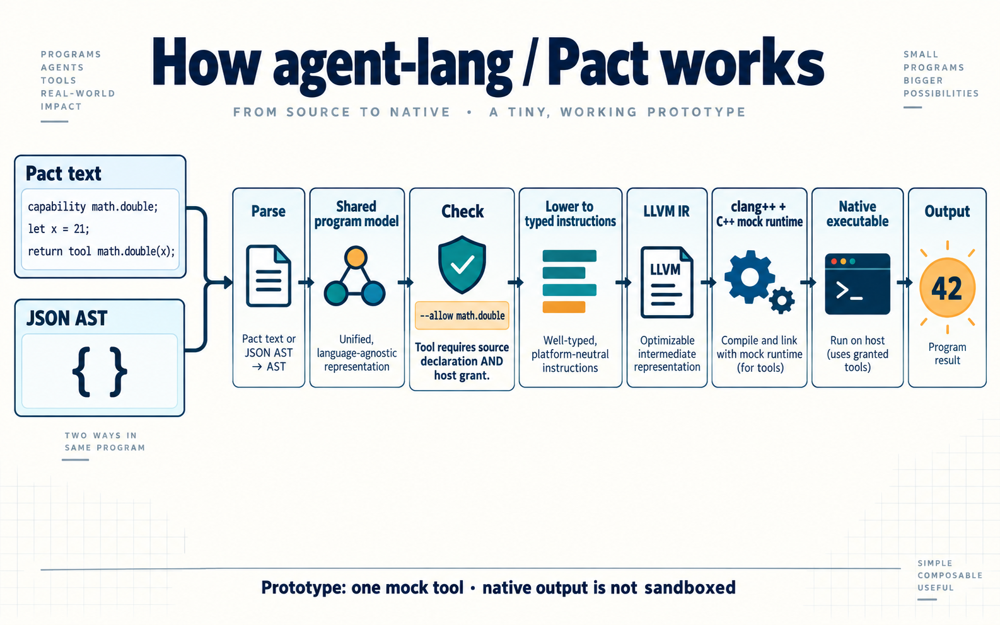
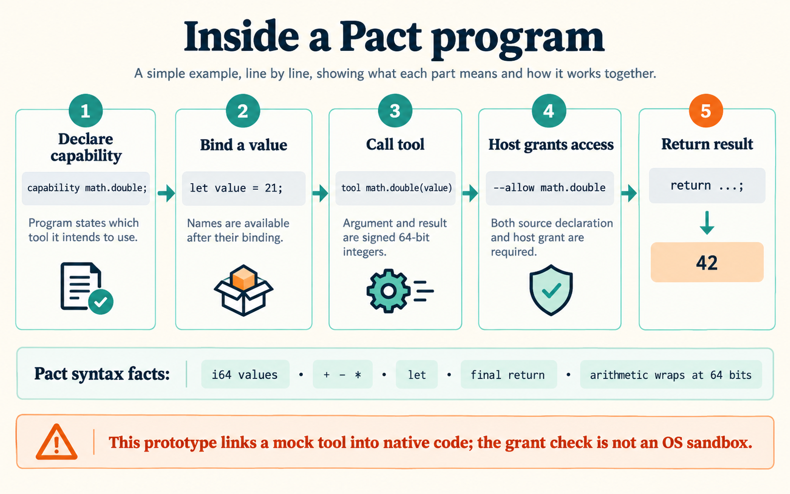
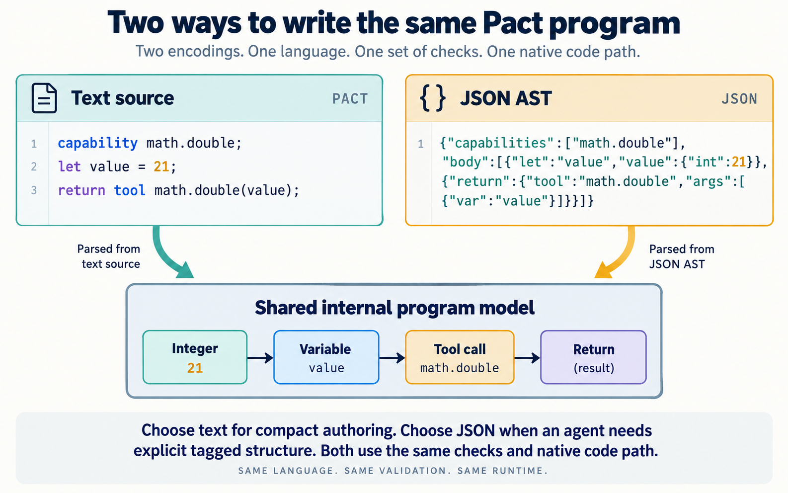
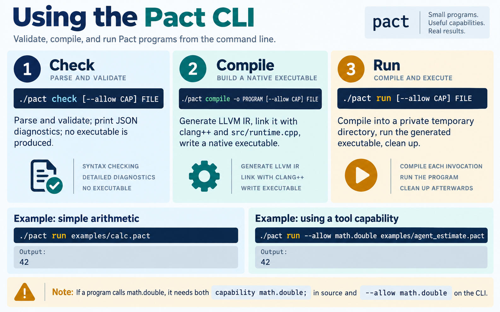
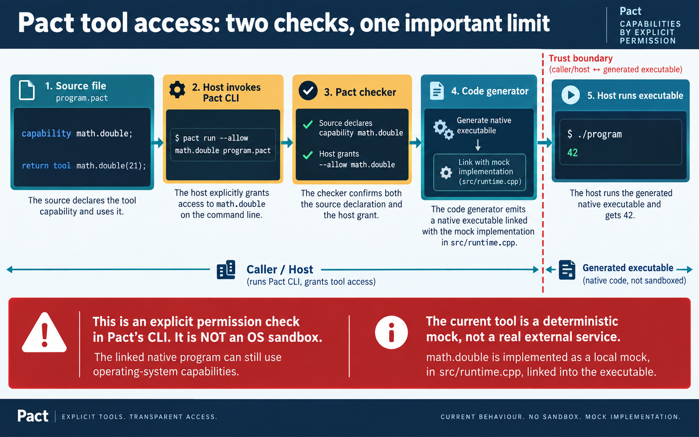
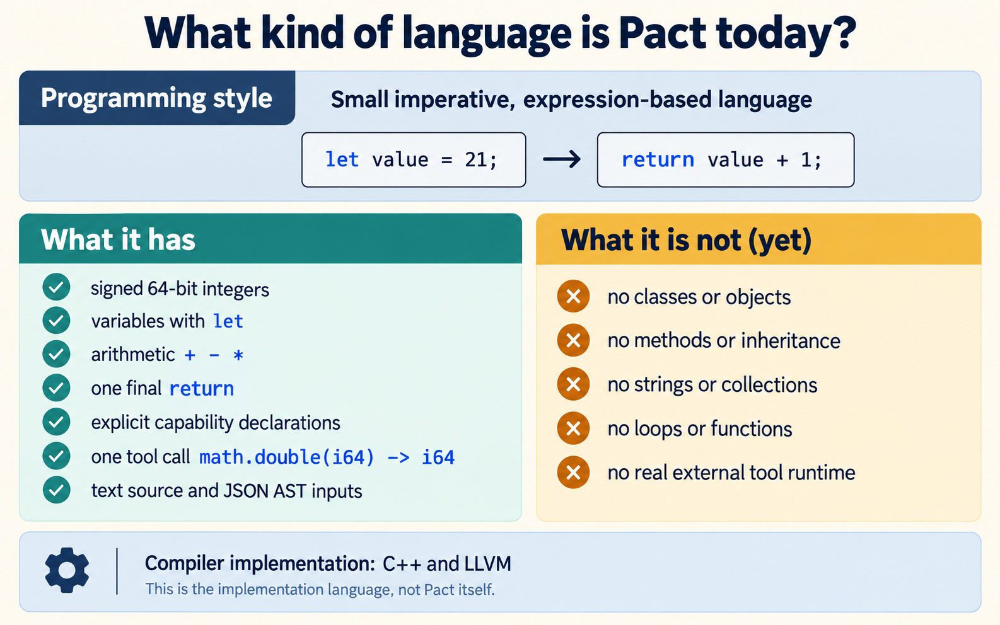
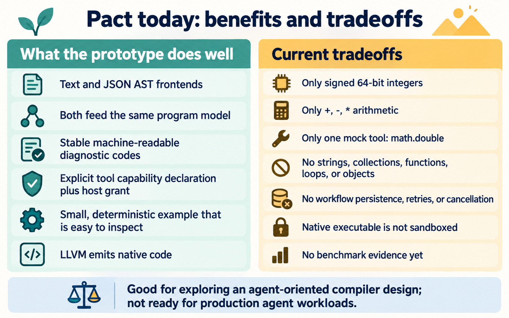
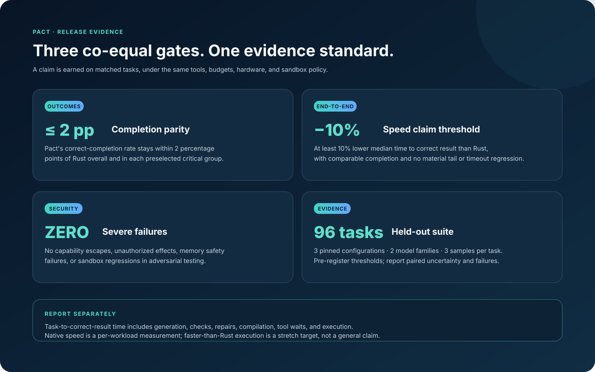

# Pact infographics

These diagrams describe the current Pact prototype. The roadmap diagram is explicitly proposed future work.

## How it works

### Compiler and execution pipeline

### A program, line by line

### Two input formats, one program model

### CLI workflow

### Capability boundary

## What Pact is today

### Language overview

### Benefits and tradeoffs

## Roadmap and release evidence

### Updated roadmap

### Release gates

The roadmap is proposed sequencing, not a delivery commitment. The older concept sketch remains available as [pact-proposed-roadmap.png](pact-proposed-roadmap.png). Performance claims require representative evaluation against comparison baselines.

## Linux sandbox for `pact run`

`pact run` compiles the program on the host, then invokes a fail-closed Linux
launcher for execution. The launcher uses bubblewrap user, PID, IPC, UTS, and
network namespaces, starts a new session, and exposes the executable and
runtime libraries read-only. It does not mount the host home directory or
workspace. Program scratch uses a private 64 MiB `/tmp` tmpfs.

The run profile is 30 seconds wall time, a 5 second CPU rlimit with aggregate
cgroup CPU accounting, 256 MiB cgroup memory, 16 cgroup tasks, and 1 MiB
combined captured stdout and stderr. These cgroup properties are applied by a
per-user systemd scope. Output is bounded before it is forwarded. If bubblewrap,
the user systemd manager, required cgroup properties, or namespace setup is
unavailable, Pact returns a machine-readable `PACT-S` diagnostic and does not
execute the program directly.

`math.double` is a deterministic in-process mock, not a real external tool.
This boundary applies only to `pact run`: compilation stays outside it, and an
executable produced by `pact compile` runs without this boundary if launched
directly. The launcher depends on the host's Linux, bubblewrap, Python, systemd,
and cgroup v2 configuration; it is an initial execution boundary, not a claim
of protection against every kernel or launcher defect.
